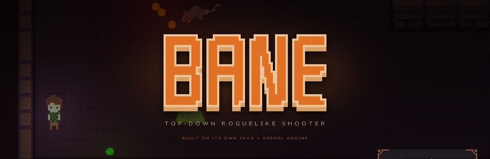
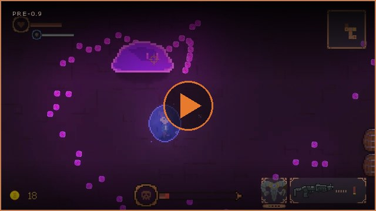
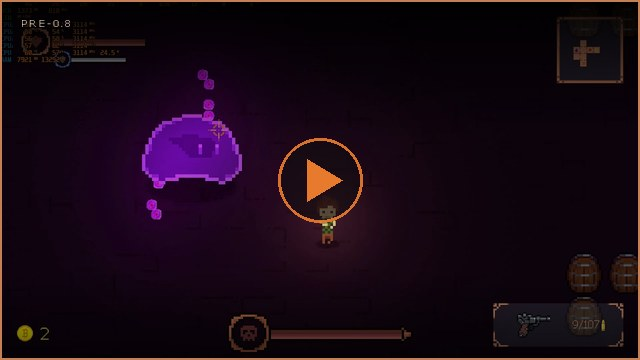
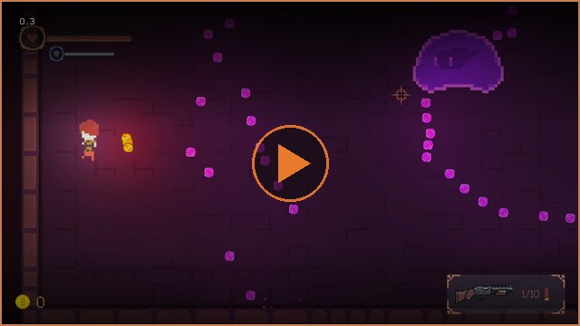
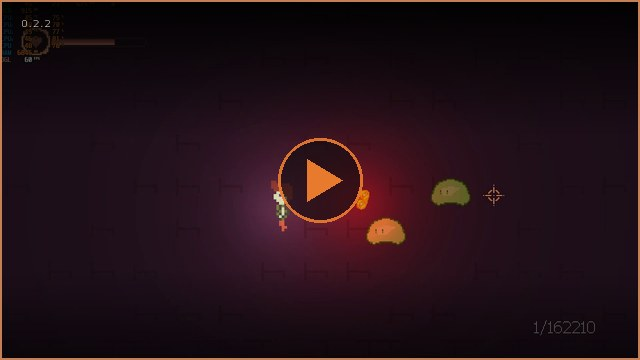

> [!WARNING]
> **This repository is archived. Bane has been replaced by a new version, rebuilt in Rust: [Bane Remastered](https://github.com/Empatixx/Bane-remastered).**
> It has 17 guns, 7 bosses, 7 biomes and much more. Please play and follow the new version.
> This Java version will not get any more updates.

<div align="center">



**A 2D top-down roguelike shooter — and the game engine underneath it — written from scratch in Java.**

[](https://openjdk.org/)
[](https://www.lwjgl.org/)
[](https://www.opengl.org/)
[](https://maven.apache.org/)
[](#running-it)
[](LICENSE)

</div>

Descend floor by floor through a procedurally generated dungeon, kill everything in the room,
spend what drops, and get a little further than last run. There is no third-party game engine
here — the renderer, the audio, the collision system, the pathfinding, the map generator and the
netcode are all part of this repository, sitting directly on top of LWJGL and OpenGL.

It started as a small side project and grew considerably past that.

## Showcase

<table>
  <tr>
    <td width="50%" align="center">
      <a href="https://youtu.be/7VNFBQoQolU"></a>
      <br><b>Pre-0.9</b> — artefacts, boss fights, floor affixes
    </td>
    <td width="50%" align="center">
      <a href="https://youtu.be/Ns-91Wz9pA0"></a>
      <br><b>Pre-0.8</b> — lighting, particles, shop
    </td>
  </tr>
  <tr>
    <td width="50%" align="center">
      <a href="https://youtu.be/mgJt5zwZRjQ"></a>
      <br><b>0.3</b> — weapons, minimap, room generation
    </td>
    <td width="50%" align="center">
      <a href="https://youtu.be/-tEU9neDSlA"></a>
      <br><b>0.2.2</b> — the early engine
    </td>
  </tr>
</table>

<div align="center"><sub>Click any frame to watch the run on YouTube.</sub></div>

## The run

Every floor is generated fresh: a starter room, a handful of combat rooms, a loot room, a shop
and a boss room, stitched together with corridors and revealed on the minimap as you clear them.
Entering a room locks the doors until the last enemy is down. The ladder appears when the boss
dies, and the next floor is harder — enemy health scales by `12 × floor²` percent.

Between runs you land in the **progress room**, where an NPC sells permanent upgrades for the
coins you carried out. Those upgrades — and your coin balance — live in a local SQLite database,
so they survive death.

### Floor affixes

Each floor rolls its own modifiers, shown on the title card as you walk in.

| Affix | Effect |
|---|---|
| **Rare potions** | Healing potion drops get rerolled — expect to find far fewer |
| **Inflation** | Shop prices doubled |
| **Fortified** | Enemy health ×1.4, on top of the floor scaling |
| **Raging** | Enemies below 20% health speed up by 30% |
| **Regeneration** | Enemies heal 2% of their max health every 5 seconds |

### Arsenal

Nine weapons, two carried slots, each with its own upgrade track in the progress room.

`Pistol` · `Luger` · `Revolver` · `Shotgun` · `Modern shotgun` · `Uzi` · `Thompson` · `M4` · `Grenade launcher`

### Bestiary

`Slime` · `Red slime` · `King slime` *(boss)* · `Rat` · `Bat` · `Eyebat` · `Demoneye` · `Ghost` · `Golem` · `Snake`

Enemies pathfind to you around walls and obstacles, and several of them shoot back with their own
projectile types.

### Artefacts

Active items with charges, found on the floor or bought from the shopkeeper.

| Damage | Support | Special |
|---|---|---|
| Rage potion | Ammo belt | Lucky coin |
| Ring of fire | Berserk potion | Revive book |
| | Shield horn | Trophy |
| | Armor potion | |

Rooms also fight back on their own: barrels, pots and crystals that break, spikes, arrow traps
and flamethrowers that do not care whose side you are on.

## The engine

| Area | What it does |
|---|---|
| **Rendering** | Modern OpenGL 3.0+ — VBOs, instanced draw calls for bullets and particles, sprite sheet animation, an autotiling tilemap |
| **Shaders** | 15 GLSL programs: geometry, instancing, lighting, outlines, blur, fade, spawn effects, health bars, text, weapon rotation |
| **Post-processing** | Dynamic per-light rendering, gaussian blur, screen fades, vignettes for blind and armor states |
| **Audio** | OpenAL through LWJGL — positional effects, music tracks, independent volume for music and effects |
| **Physics** | AABB tilemap collision, SAT for rotated hitboxes, knockback and separation between entities |
| **AI** | A* over the room grid, with line-of-sight, states and per-enemy attack behaviour |
| **Map generation** | Random room graph per floor, room templates loaded from `.map` files, corridor carving, autotiling, minimap |
| **Persistence** | SQLite over JDBC for coins and weapon upgrade levels |
| **Game loop** | Frame-rate independent, delta-time driven, with a loading screen that streams textures and audio up front |
| **Extras** | Discord Rich Presence, in-game screenshots, remappable controls, resolution and brightness settings |

### Algorithms

| | |
|---|---|
| **AABB** | Tilemap and entity collision |
| **A\*** | Enemy pathfinding |
| **SAT** | Rotated / oriented hitboxes |

## Multiplayer

Co-op over [KryoNet](https://github.com/EsotericSoftware/kryonet) on port `54555`, with an
authoritative server that owns enemies, drops and map generation. **It works, but it is not
finished** — expect rubber-banding under latency.

| | Status |
|---|---|
| Client interpolation | ✅ Done |
| Client input prediction | 🟦 In progress |
| Client lag compensation | 🟦 Planned |
| Server lag compensation | 🟦 Planned |

## Controls

| Action | Default | | Action | Default |
|---|---|---|---|---|
| Move | `W` `A` `S` `D` | | Weapon slots | `1` `2` |
| Shoot | `Left mouse` | | Drop weapon | `Q` |
| Reload | `R` | | Interact | `E` |
| Map | `Tab` | | Use artefact | `F` |

All of them are remappable from the in-game settings.

## Running it

### Requirements

- **Windows.** Only Windows LWJGL natives are vendored in `libraries/`, and asset paths across the
  codebase are written with backslashes, so a Linux or macOS run will not find its textures.
- **JRE 1.8+** and a GPU supporting **OpenGL 3.0+**.
- **~250 MB RAM** for singleplayer, **500 MB+** for multiplayer.
- [Maven](https://maven.apache.org/) to build from source.

### Build

```sh
mvn clean package dependency:copy-dependencies
```

The LWJGL native classifier is picked automatically by the Maven profiles in `pom.xml`
(`natives-windows`, `natives-windows-x86`, `natives-linux`).

### Run

```bat
java -Djava.library.path=libraries -cp "target/Bane-0.9.jar;target/dependency/*;libraries/*" cz.Empatix.Main.Game
```

**Run it from the repository root.** `Textures/`, `Sounds/`, `shaders/` and `resources/` are
resolved relative to the working directory, and `data.db` and `settings.cfg` are written there.

## Project layout

| Path | What lives there |
|---|---|
| `src/main/java/cz/Empatix/Main` | Entry point, window and GLFW setup, input, settings, Discord RPC |
| `src/main/java/cz/Empatix/Render` | Renderer, camera, tilemap, rooms, HUD, minimap, text, post-processing |
| `src/main/java/cz/Empatix/Entity` | Player, enemies, item drops, artefacts, room objects, A\* pathfinding |
| `src/main/java/cz/Empatix/Guns` | Weapons and projectiles |
| `src/main/java/cz/Empatix/Gamestates` | Menu, singleplayer and multiplayer states, progress room |
| `src/main/java/cz/Empatix/Multiplayer` | KryoNet client and server, packets, interpolation |
| `src/main/java/cz/Empatix/AudioManager` | OpenAL wrapper, soundtracks and effects |
| `src/main/java/cz/Empatix/Buffs` | Berserk, rage, poison, blindness |
| `src/main/java/cz/Empatix/Database` | SQLite persistence |
| `shaders/` | GLSL vertex and fragment shaders |
| `Textures/`, `Sounds/` | Sprite sheets, bitmap font, music and effects |
| `resources/Map/` | Hand-authored room templates for the generator |
| `libraries/` | Vendored LWJGL natives, KryoNet, Discord RPC, SQLite JDBC |

## License

[GNU GPL v3](LICENSE).
